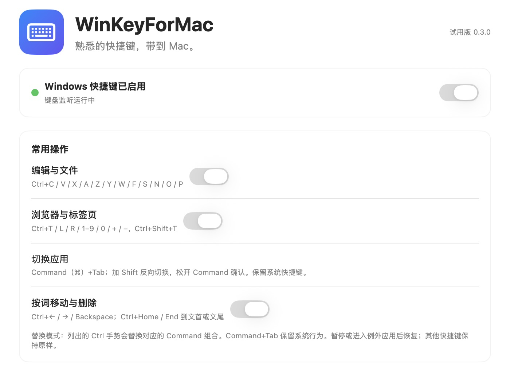
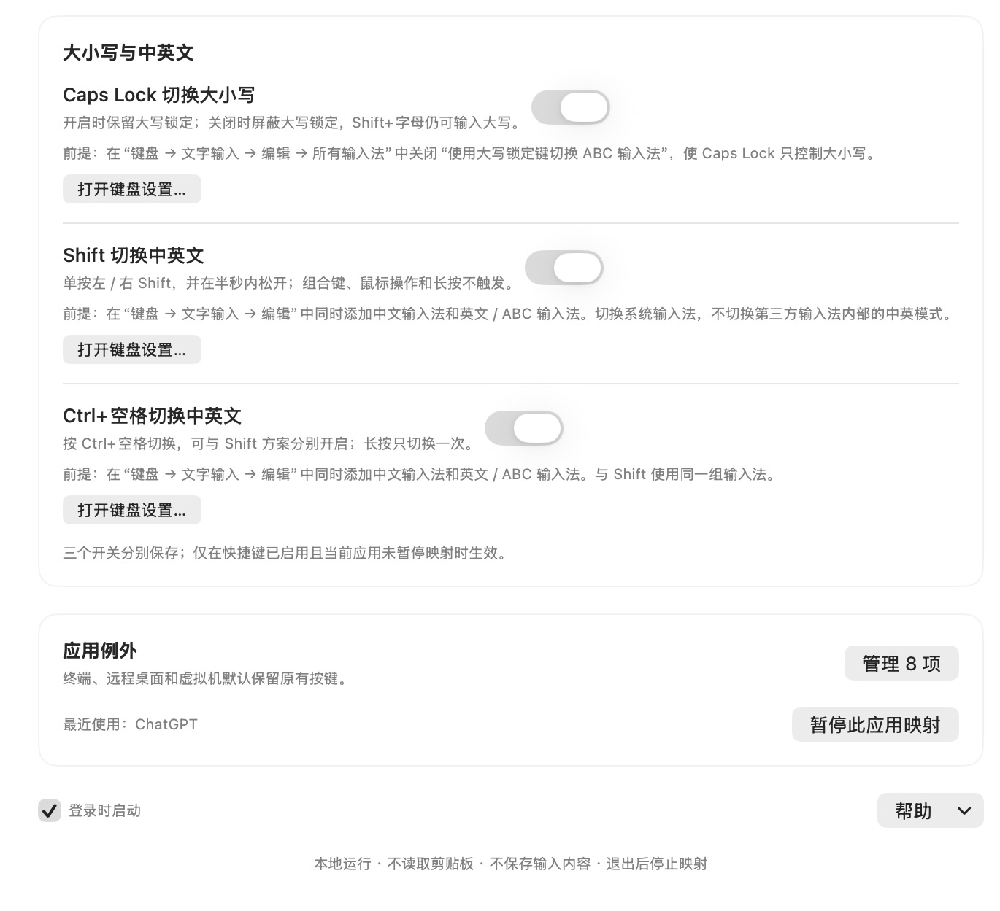

# WinKeyForMac

把熟悉的 Windows 快捷键带到 Mac。支持 Ctrl 复制粘贴、单按 Shift 切换中英文，保留 Command+Tab 切换应用，提供中文设置界面，常驻菜单栏。

需要 **macOS 13 或更新版本**。

## 界面预览

常用快捷键设置（截图版本：0.3.0）：

查看大小写、中英文切换与应用例外设置

## 开始使用

1. 将 `WinKeyForMac.app` 拖到「应用程序」文件夹，再打开。
2. 如果曾经交换过 Control 和 Command，请在「系统设置 → 键盘 → 键盘快捷键 → 修饰键」中恢复默认，并勾选应用中的确认项。内置和外接键盘需要分别检查。
3. 点击「打开授权设置」，在「隐私与安全性 → 辅助功能」中允许 WinKeyForMac，再返回应用启用快捷键。
4. 按自己的习惯开启或关闭功能组。关闭设置窗口后，应用会继续运行；点击菜单栏的 **键盘图标**，可打开设置、暂停或退出。
5. 如需开机后自动运行，可在设置中开启「登录启动」。请先将应用放在固定位置。

如果授权后仍无法启用，可从帮助菜单打开「输入监控」检查权限，再点击「重新检查并启用」。

## 有哪些功能

| 快捷键 | 功能 |
| --- | --- |
| Ctrl+C / V / X / A | 复制、粘贴、剪切、全选 |
| Ctrl+Z / Ctrl+Y / Ctrl+Shift+Z | 撤销、重做 |
| Ctrl+S / O / P | 保存、打开、打印 |
| Ctrl+N / W / F，以及对应的 Ctrl+Shift 组合 | 新建、关闭、查找等，具体操作取决于当前应用 |
| Ctrl+Shift+S | 当前应用的另存为或类似操作 |
| Ctrl+T / Ctrl+Shift+T | 新建标签页、恢复关闭的标签页 |
| Ctrl+L / R / Shift+R | 定位地址栏、刷新、强制刷新，取决于当前应用 |
| Ctrl+数字 / 加号 / 减号 | 切换标签页、缩放等，取决于当前应用 |
| Command（⌘）+Tab / Command+Shift+Tab | 保留系统应用切换；按住 Command 连续切换，松开确认 |
| 单按左或右 Shift | 切换中文与英文 / ABC 输入法，默认开启 |
| Ctrl+空格 | 切换中文与英文 / ABC 输入法，默认关闭 |
| Caps Lock | 切换大小写，默认开启；可独立关闭大写锁定 |
| Ctrl+左右箭头 / Backspace / Delete | 按词移动或删除，默认关闭；可配合 Shift 选择文字 |
| Ctrl+Home / End | 跳到文首或文尾，默认关闭；可配合 Shift 选择文字 |

**这是快捷键替换工具。** 例如，启用复制粘贴后，Ctrl+C 可以复制，对应的 Command+C 会被禁用。每组功能可单独开关；关闭对应功能、暂停应用或进入例外应用后，会恢复原有快捷键。未涉及的组合键（如 Command+Q）保持原样。

Command+Tab / Command+Shift+Tab 始终保留系统行为，切换的是 Mac 应用，不是每个独立窗口。Option+Tab 不转换为应用切换。各应用菜单中显示的快捷键不会随之改变。

### 中英文切换

单按左或右 Shift，并在半秒内松开，即可切换中英文。Shift+字母仍可输入大写，Shift+方向键仍可选择文字；长按 Shift 或搭配其他按键、鼠标操作时不会切换输入法。

请先在系统中同时添加中文输入法和英文 / ABC 输入法。应用会记住最近使用的中文与英文输入法，不会轮流切换到日文等其他输入法。这里切换的是系统输入法，不是第三方输入法内部的中英模式。Shift 与 Ctrl+空格可以同时开启。

### 大小写与中英文的独立开关

设置中的「大小写与中英文」包含三个分别保存的开关，每项都有自己的前提说明和「打开键盘设置」按钮：

- **Caps Lock 切换大小写**：默认开启。请先在「系统设置 → 键盘 → 文字输入 → 编辑 → 所有输入法」中关闭「使用大写锁定键切换 ABC 输入法」，使 Caps Lock 只控制大小写。关闭本应用的开关后，会屏蔽生效应用中的大写锁定，Shift+字母仍可输入大写；键盘指示灯仍由系统管理。
- **Shift 切换中英文**：默认开启。前提是系统中同时添加中文输入法和英文 / ABC 输入法。
- **Ctrl+空格切换中英文**：默认关闭。同样需要同时添加中文输入法和英文 / ABC 输入法；与 Shift 使用同一组输入法，可以分别或同时开启。

这些开关仅在快捷键已启用且当前应用未暂停映射时生效；暂停、退出或进入例外应用后，Caps Lock 恢复系统行为。

### 应用例外

终端、iTerm2、Warp、Windows App / Microsoft 远程桌面、Parallels、VMware、AnyDesk、TeamViewer 默认暂停快捷键替换，避免影响终端操作、远程控制或虚拟机。你可以在设置中调整例外名单，也可以通过菜单栏暂停最近使用的应用。

VS Code 的编辑器和集成终端共用同一套规则。如果需要在集成终端用 Ctrl+C 中断命令，请暂停 VS Code 的快捷键替换。

## 安全与隐私

- **本地运行**：不发送网络请求，不读取剪贴板，不记录或保存输入内容；功能开关和应用例外等偏好保存在本机。
- **权限用途**：需要辅助功能权限来识别和替换快捷键。这是可控制其他应用的系统权限，请只向可信来源的应用授权。
- **密码输入**：macOS 开启安全输入时，应用会暂停快捷键替换。
- **随时恢复**：出现快捷键冲突或异常时，可从菜单栏暂停或退出；退出后恢复系统原有快捷键。应用不会替你修改系统的 Control / Command 设置。
- **安装提示**：当前应用尚未经过 Apple 开发者身份认证和公证，macOS 可能显示安全提示。确认应用来源可信后，可到「系统设置 → 隐私与安全性」中选择「仍要打开」；移动或更新应用后，可能需要重新授权。
- **卸载**：先关闭「登录启动」并退出应用，再从「应用程序」文件夹中删除；可在系统设置中撤销相关权限。

## 开源协议

本项目采用 [MIT 协议](LICENSE)，允许使用、修改和分发，包括商业用途；分发时须保留版权与许可声明。软件按原样提供，不作担保。
